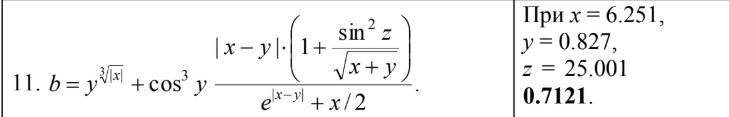
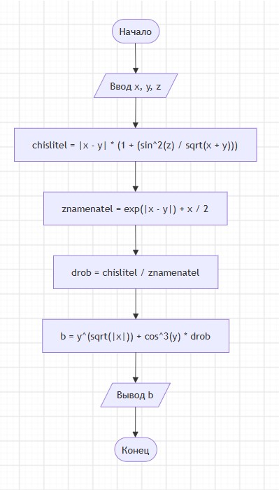

## Домашнее задание к лабораторной 5

### Вариант 11

#### Задание. Создать программу вычисления указанной величины.Результат проверить при заданных исходных значениях.

#define _CRT_SECURE_NO_WARNINGS

#include <stdio.h>

#include <math.h>

#include <locale.h>

int main()

{

	setlocale(LC_ALL, "RUS");

	double x, y, z, b;

	double chislitel, znamenatel, drob;

	printf("Введите x:");

	scanf("%lf", &x);

	printf("Введите y:");

	scanf("%lf", &y);

	printf("Введите z:");

	scanf("%lf", &z);

	chislitel = fabs(x - y) * (1.0 + pow(sin(z), 2) / sqrt(x + y));

	znamenatel = exp(fabs(x - y)) + x / 2.0;

	drob = chislitel / znamenatel;

	b = pow(y, sqrt(fabs(x))) + pow(cos(y), 3)* drob;

	printf("\nПри x = %.3f, y = %.3f,z=%.3f\n", x, y, z);

	printf("Результат b=%.4f\n", b);
	return 0;
}

### Вывод

####  Лабораторной работе №5 были успешно закреплены практические навыки использования функций cтандартной математической библиотеки языка Си. В рамках задания спроектирована и написана программа, вычисляющая сложное математическое выражение с использованием вещественных переменных и функций (sqrt, pow,fabs, exp). Алгоритм работает корректно , и полностью совпадает с представленной блок-схемой.